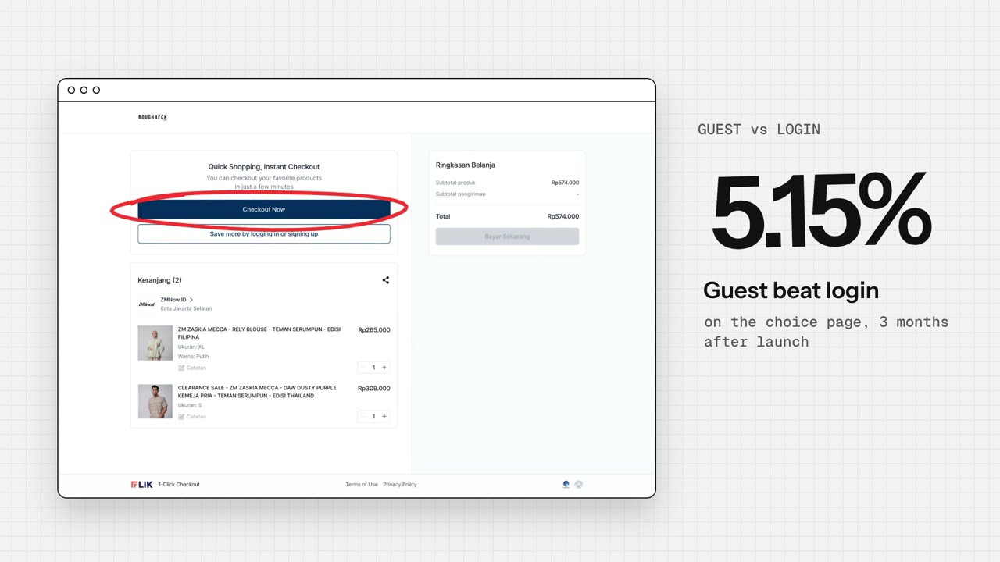
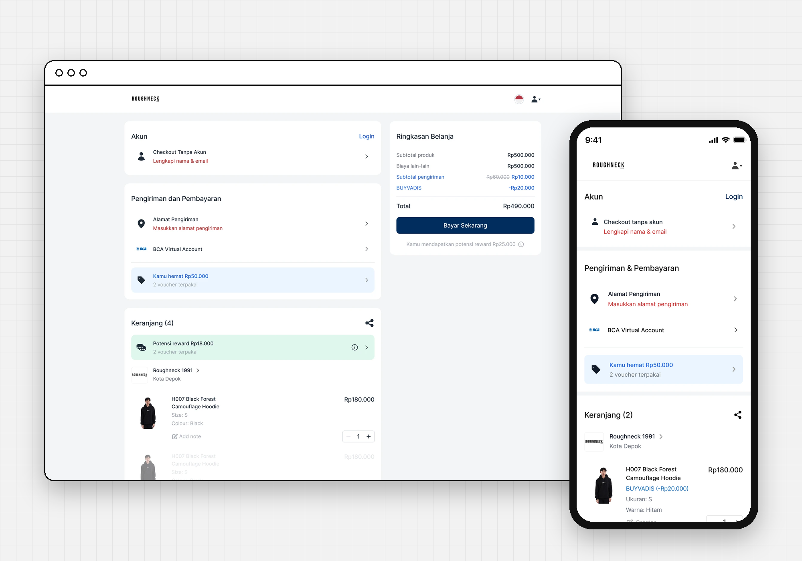
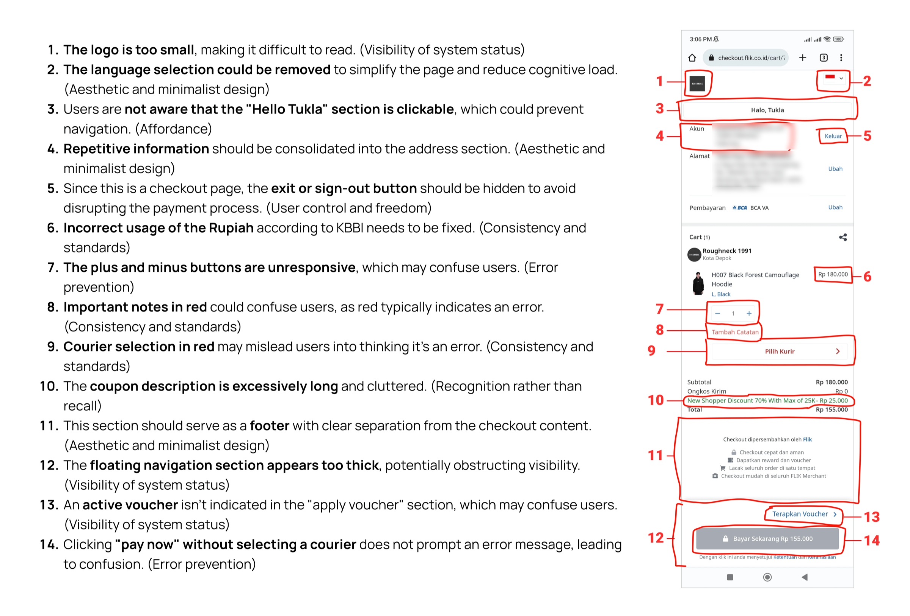
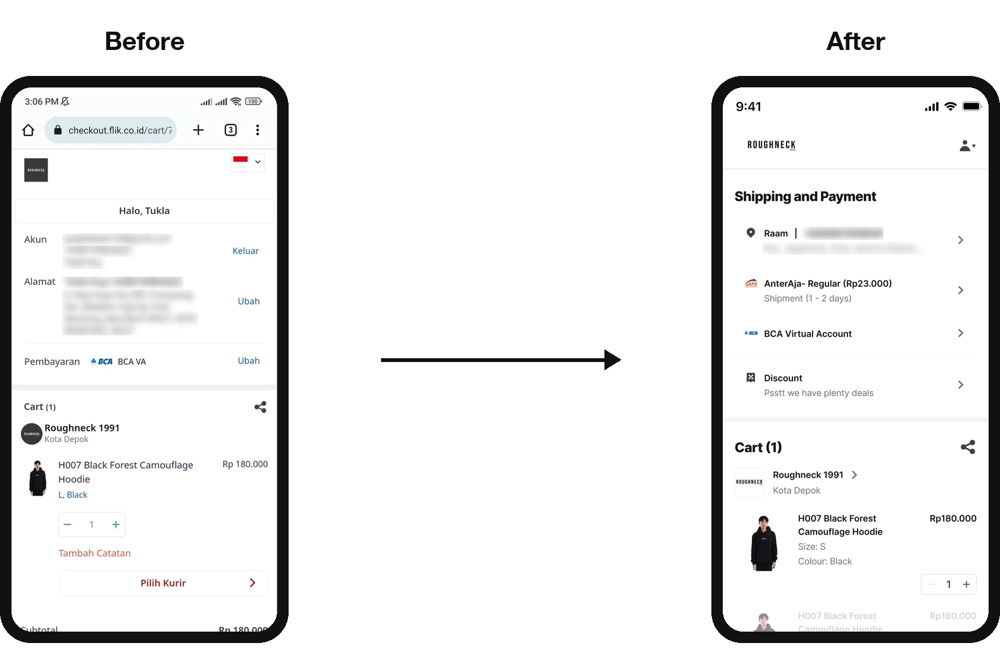
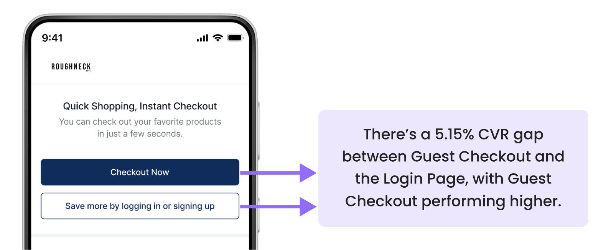
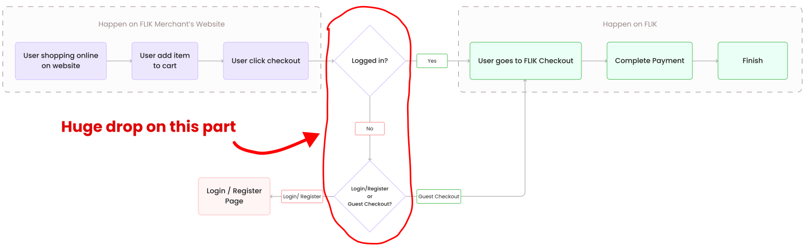
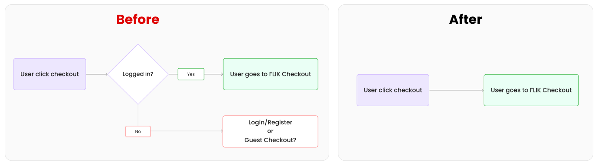
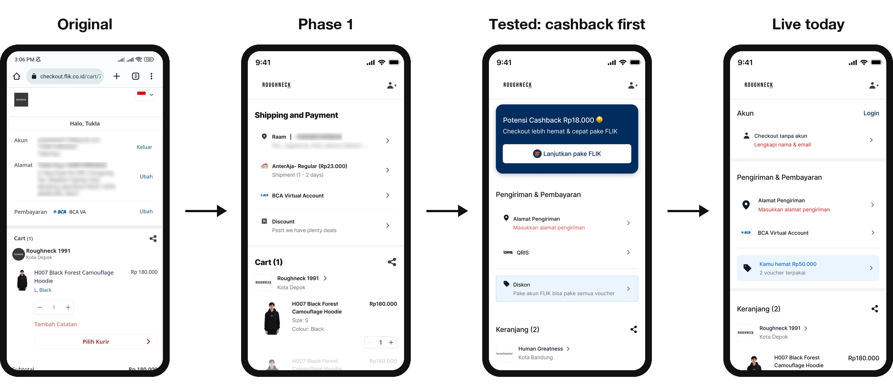

# FLIK Checkout: Making One-Click Checkout Worth Logging In For

**Four phases of research and redesign on FLIK's checkout entry, from a heuristic audit to the one-step checkout that's live today.**

[**Read the full case study →**](https://raam-portfolio-eta.vercel.app/work/flik-checkout) · [Watch the 80-second video](https://raam-portfolio-eta.vercel.app/work/flik-checkout#watch)

---

## Overview

| | |
|---|---|
| **Company** | FLIK, a one-click checkout and merchant platform (Indonesia) |
| **Role** | Product Designer, leading the research. One of two designers, working with the CEO, two PMs and engineering |
| **Timeline** | Aug 2023 – Jun 2025 |
| **Platform** | Mobile and desktop web checkout, embedded on merchant sites |
| **Methods** | Heuristic evaluation, funnel data, unmoderated testing (Maze), guerrilla testing |

---

## The trade-off behind every phase

Brands add FLIK to their own websites as a one-click checkout. When a shopper clicks "checkout" on the merchant's site, they land on FLIK. If they're logged in, their address and payment are already filled in on every FLIK merchant, and they earn cashback.

The easiest path for a shopper is guest checkout. The path that makes FLIK valuable is logging in. **Every phase of this project was about making checkout easier without making login feel optional.**

| Phase | What happened |
|---|---|
| **1 · Audit and redesign** | No data yet, so I started with a heuristic review of the live checkout and shipped a cleaner page. |
| **2 · A 5.15% gap** | Guest checkout beat login. Research showed shoppers wanted the rewards but chose guest because it felt faster. |
| **3 · A drop-off at the login step** | A one-month session fix shipped right away, while a one-step flow was tested. |
| **4 · Balancing the two paths** | Three more test rounds, then the version that's live today. |

---

## Phase 1 · Start with what you can see

- **Trigger:** an open brief from the CEO to improve checkout. No target metric, no analytics.
- **Method:** a heuristic evaluation on Android, then 4 rounds of feedback with the CEO.
- **Result:** a clearer checkout, plus FLIK's first desktop version. Not measured.

This was my first project at FLIK, and the company was a year old, so there was no data to start from. I reviewed the live checkout against standard usability heuristics and found **14 issues**. Most were about clarity: a logo too small to read, repeated information, a cluttered coupon section, and a "Pay now" button that failed silently when no courier was chosen.

I took low-fidelity fixes through four rounds with the CEO, then moved to high fidelity. With no PM yet, I also briefed engineering and ran the handoff. The CEO then asked for a desktop version, which FLIK hadn't had.

> **Takeaway:** without a baseline, I couldn't show whether this worked. From then on, each phase started from data or research.

---

## Phase 2 · Shoppers wanted rewards, but chose speed

- **Trigger:** three months after guest checkout launched, it converted **5.15% better** than login.
- **Method:** an unmoderated study in Maze with about 20 recent guest and logged-in buyers.
- **Result:** a new understanding of the problem, and a recommendation to make the reward visible.

FLIK added guest checkout to reduce friction: pay with just a name, email and phone number. Another designer led it. I'd argued it would undercut login, then committed to making it work. Three months later the data showed the risk: on the page where shoppers choose, guest checkout was winning.

The obvious move was to rearrange the buttons. I wanted to know **why** people chose guest first. The study asked what shoppers cared about before showing any screen, then had them check out and explain their choice.

| Result | |
|---|---|
| **100%** | said they'd rather save with rewards |
| **68%** | still chose guest checkout |
| **9.1/10** | rated checkout easy |

**The insight:** shoppers wanted what logging in gives them, but chose guest because it *felt* faster, even though logged-in checkout is the faster one. The benefit of logging in was invisible.

**Decision:** keep the layout, because guest checkout supported the business priority at the time (transaction volume), and make the benefit of logging in obvious. Engineering had other priorities, so it waited, but this insight shaped every phase after.

---

## Phase 3 · Fix the leak now, redesign the step next

- **Trigger:** the PM spotted a significant drop-off on the log-in-or-guest page.
- **Method:** root cause with engineering, then guerrilla testing of a one-step flow (10 people, Figma prototype, phones and laptops).
- **Result:** logins extended from 48 hours to 1 month (shipped). The one-step flow was validated, with a new risk.

**The quick fix.** Logged-in shoppers should skip that page entirely, but logins expired every 48 hours, sending returning shoppers back to it. The 48 hours existed for security on shared devices and to keep stored carts small. Engineering said cart size was manageable. As for security, being logged in never moves money on its own: QRIS and virtual-account payments are approved in the shopper's own bank or e-wallet app, and cards go through 3-D Secure. So we extended logins to **one month**, and it shipped.

**The bigger fix.** After a competitor review and a brainstorm with the PM, we proposed removing the page altogether: click checkout, land on checkout.

It was a big change, so we tested it quickly with 10 people recruited near our office.

- **What worked:** it felt more straightforward, with fewer decisions and less commitment before seeing the order.
- **What didn't:** people still didn't know logging in earns cashback, and guest checkout became even more dominant.

---

## Phase 4 · Make the reward visible

- **Trigger:** the one-step flow made guest checkout too dominant.
- **Method:** three more rounds of iteration and usability testing.
- **Result:** clicks between guest and login evened out in testing. A one-step checkout that shows the reward shipped.

The answer came from phase 2: shoppers log in when they can see what they'll get. So I tested a checkout that opens with the shopper's **actual potential cashback** and a single "Continue with FLIK" button, while guest checkout stays one tap away.

The CEO preferred a different look for the final screen, so I rebuilt it around the same tested principles: one step for everyone, with the shopper's **potential reward** shown in the cart and right under the pay button. That version is live today.

---

## Impact, honestly

- **Shipped:** a redesigned checkout and FLIK's first desktop version, logins that last a month instead of 48 hours, and a one-step entry that shows the shopper's potential reward where they pay.
- **Changed how the team saw the problem:** the gap between guest and login was about perceived value, not button placement.
- **Not measured yet:** FLIK doesn't currently track the checkout funnel, so I can't claim a conversion number. The first thing I'd measure is the share of logged-in checkouts before and after launch, then A/B test how the reward is shown.

## What I'd do differently

- **Agree on a success metric before designing.** Phase 1 shipped with nothing to measure it against; I now put a metric in every brief.
- **Ask for an experiment before big launches.** I disagreed with how guest checkout launched; a test with a clear success metric would have settled it with data.
- **Pair small tests with funnel data.** Ten guerrilla participants give direction, not proof.

---

*Contact details in the screenshots are blurred.* · [Raam Pujangga Sadewa](https://raam-portfolio-eta.vercel.app) · Product Design Engineer
